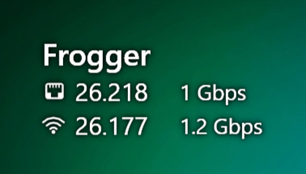
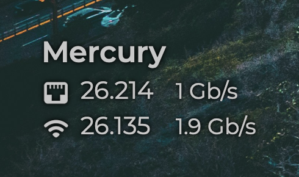

# Hostcard widget

A small desktop widget for **Windows 11** and **macOS** that shows which machine you're on:
the **hostname, IP address, MAC address, connection type (LAN or Wi-Fi) and link speed**.

Handy when you hop between several machines over Moonlight or Remote Desktop and can't remember which is which:
the answer sits right there on the desktop, under your windows.

| Windows | macOS |
| --- | --- |
|  |  |
| One widget lists every active adapter, with a Wi-Fi or Ethernet icon per row. | One widget lists every active interface, with a Wi-Fi or Ethernet icon per row. |

Both start on **Automatic**: every connected Wi-Fi and Ethernet adapter with an IPv4 address gets a row
(so a machine on both LAN and Wi-Fi shows two), and VPN and other virtual adapters are left out.
Menu → **Interfaces** picks specific ones instead.

## What it shows

| Field | Windows | macOS |
| --- | --- | --- |
| Hostname | yes | yes |
| IPv4 address (full, last two parts, or last part) | yes | yes |
| MAC address | yes | yes |
| Type | icon: Ethernet port / Wi-Fi | icon: Ethernet port / Wi-Fi |
| Link speed | yes | yes (Wi-Fi: current transmit rate) |

On Windows, the type icons and one row per adapter come with [#6](https://github.com/markespiritu/hostcard-widget/pull/6).

Every field can be hidden (for example the MAC, for privacy), and the font, size, weight, colour and spacing are all adjustable.
The info refreshes as soon as the network changes, and on a timer as well (Wi-Fi speed moves around).

## Moving it

The widget ignores the mouse, so clicks go straight through to whatever is underneath.
To grab it, **hold the modifier keys**:

| | Windows | macOS |
| --- | --- | --- |
| Modifier | **Shift + Alt** | **Shift + Option** |
| Move | modifier + drag | modifier + drag |
| Options menu | modifier + right-click | modifier + right-click |
| Resize | modifier + mouse wheel, or drag the bottom-right corner | font size in the options menu |

A blue outline shows while the keys are held. The position is remembered (on the Mac, for each display setup, so it comes back when a monitor is plugged in or unplugged).
Shift + Alt was chosen because it passes through Moonlight: from a Mac, press **Shift + Option**
(Moonlight sends Option to Windows as Alt).

## Install

There is no installer and no update check. Each build is one portable file you copy to the machine yourself.

**Windows 11:** copy `IpWidget.exe` anywhere and run it. No .NET install needed. Use **Start with Windows** in the menu to have it come back after a reboot.

**macOS 13 or later:** copy `IPWidget.app` to `/Applications` (or anywhere) and open it. It has no Dock icon.
The app is ad-hoc signed, not notarized, so on a Mac that didn't build it, the first launch is blocked:
right-click the app, choose **Open**, then **Open** again, or run `xattr -dr com.apple.quarantine IPWidget.app`.
Use **Launch at login** in the menu to start it automatically.

## Build

| | Windows | macOS |
| --- | --- | --- |
| Needs | .NET 8 SDK | Xcode command-line tools (`xcode-select --install`) |
| Command | `.\build.ps1` (x64) or `.\build.ps1 -Arch arm64` | `mac/build.sh` |
| Output | `dist\IpWidget.exe` (single self-contained exe) | `mac/build/IPWidget.app` (universal arm64 + x86_64) |

Builds are done locally, not in CI.

## More detail

- [Windows guide](docs/windows.md): every menu option, choosing adapters, where settings are stored.
- [macOS guide](mac/README.md): every menu option, choosing interfaces, where settings are stored.

## Repository layout

```
src/IpWidget/   Windows app (C#, WPF, .NET 8)
build.ps1       Windows build script
mac/            macOS app (Swift, AppKit) and mac/build.sh
docs/           Windows guide and screenshots
```

The apps themselves are still named **IP Widget** (`IpWidget.exe`, `IPWidget.app`).
