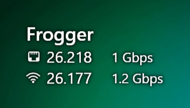

# Hostcard widget for Windows



The Windows version shows the **hostname**, then one row per network adapter: **type icon, IP address, MAC address and speed**.
The type is a Wi-Fi symbol or an Ethernet port. A machine on both LAN and Wi-Fi shows two rows, like the Mac version.
The icons and one row per adapter come with [#6](https://github.com/markespiritu/hostcard-widget/pull/6).
It needs Windows 11. Back to the [main README](../README.md).

## Install

1. Copy `IpWidget.exe` anywhere on the machine. It's a single portable file: no installer, no .NET install needed.
2. Run it. The widget appears at the top-right of the main screen, sitting on the desktop underneath your windows.

To move it to another PC, copy the same exe across. There is no update check; copy a newer exe over the old one to update.

## Use it

| Action | How |
| --- | --- |
| Move it | Hold **Shift + Alt** and drag it. The border turns blue while Shift + Alt are held. Position is remembered. |
| Resize it | Hold **Shift + Alt** and scroll the mouse wheel over it, or hold **Shift + Alt** and drag its bottom-right corner. Size is remembered; menu → **Reset size** goes back to 100%. |
| Options menu | Hold **Shift + Alt** and right-click it. |
| Pick adapters | Menu → **Interfaces**. *Automatic (all active)* shows every connected Wi-Fi and Ethernet adapter that has an IPv4 address; VPN, Hyper-V, VMware, Bluetooth and other virtual adapters are left out. Tick specific adapters to show only those; a ticked adapter that's unplugged or off stays visible, dimmed, as "disconnected". Untick them all to go back to Automatic. |
| Hide fields (e.g. the MAC, for privacy) | Menu → **Show fields** and untick any of hostname, IP, MAC, type icon, speed. This applies to every row. |
| Short IP (e.g. `26.218`) | Menu → **IP address format** → Full / Last two parts / Last part only (every row). |
| Font, size, style, colour, spacing | Menu → **Font, style, color and spacing…** opens one dialog: a searchable font list (one font for every field), a size, weight (Light to Black), italic and underline per field, the text colour (presets or **Custom…**), hostname capitalization (UPPERCASE, Capitalized `Frogger`, lowercase, as named in Windows), and spacing sliders (between rows -60 to 40, so rows can overlap; between columns -40 to 80). The widget updates as you change things; **OK** keeps them, **Cancel** or **Esc** undoes them. Dark colours automatically get a light panel / light halo. |
| Close the menu | **Esc**, or click anywhere else. |
| Text only, no background | Menu → untick **Show background**. The text gets a dark halo so it stays readable; holding Shift + Alt shows a faint outline so you can still grab it. Untick **Text shadow** to drop the halo too. |
| Show it above windows | Menu → **Keep on top of other windows** |
| Start with Windows | Menu → **Start with Windows** (adds a shortcut to your Startup folder) |
| Lost it off-screen | Menu → **Reset position** (it also resets itself if its saved spot is no longer on any screen) |
| Quit | Menu → **Exit** |

Without Shift + Alt held, the widget ignores the mouse completely, so clicks go through to the desktop or window beneath it.

**From a Mac (e.g. over Moonlight):** press **Shift + Option**. Option is the Mac key in the Alt position, and Moonlight sends it to Windows as Alt.

The info refreshes as soon as Windows reports a network change, and every 15 seconds anyway (Wi-Fi link speed moves around).

## A second widget

One widget already lists every adapter. If you'd rather have two separate widgets (say, one per adapter in
different corners), run the exe a second time. Each copy takes the next free **slot** (1, 2, 3 …) and keeps its own
interfaces, position, look and on-top setting.
You can also choose the slot yourself: `IpWidget.exe --slot 2`. The "Start with Windows" shortcut for each slot
launches that slot, so both come back after a reboot.
A widget set up with an older version that showed one chosen adapter keeps showing that adapter (as a one-item
Interfaces selection); one on Automatic now shows every active adapter.

Settings live in `%APPDATA%\IpWidget\slot1.json`, `slot2.json`, …

## Build

Needs the .NET 8 SDK. From the repository root:

```powershell
.\build.ps1              # -> dist\IpWidget.exe (x64)
.\build.ps1 -Arch arm64  # -> dist\IpWidget-arm64.exe
```

The output is a single self-contained exe; copy it to each machine.
