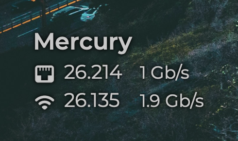

# Hostcard widget for macOS



The Mac version sits on the desktop (above the wallpaper and desktop icons, below every window, on all Spaces)
and shows **the hostname, then one row per network interface: Wi-Fi or Ethernet icon, IPv4 address, MAC address
and link speed**. Back to the [main README](../README.md).

By default it shows every active Wi-Fi and Ethernet interface that has an IPv4 address (so a Mac with both
Wi-Fi and a USB-C LAN adapter shows two rows). Thunderbolt Bridge, VPN tunnels, AWDL and other virtual
interfaces are left out.

## Install

Needs macOS 13 or later. There's no installer and no update check.

1. Copy `IPWidget.app` to `/Applications` (or anywhere).
2. Open it. It has no Dock icon; the widget appears on the desktop.

The app is ad-hoc signed, not notarized, so on a Mac that didn't build it Gatekeeper blocks the first launch.
Either right-click the app → **Open** → **Open**, or run:

```bash
xattr -dr com.apple.quarantine IPWidget.app
```

## Use it

| Action | How |
| --- | --- |
| Move it | Hold **Shift + Option** and drag it. A blue outline shows while the keys are held. Position is remembered for each display setup: unplug or plug in a monitor and it goes back to where you last put it with that set of screens (or on that screen). |
| Options menu | Hold **Shift + Option** and right-click it. **Esc** closes the menu. |
| Pick interfaces | Menu → **Interfaces**. *Automatic (all active)* shows every connected Wi-Fi/Ethernet interface. Tick specific ones to show only those; a ticked interface that's unplugged stays visible, dimmed, as "disconnected". |
| Hide fields | Menu → **Show fields**: hostname, IP, MAC, type icon, interface name (en0, off by default), speed. |
| Short IP (e.g. `26.214`) | Menu → **IP address format**. |
| Font, size, style, colour, spacing | Menu → **Font, style, color and spacing…**: searchable font list (one font for every field), size, weight (Light to Black), italic and underline per field, colour presets or **Custom…**, hostname capitalization, and row (-60 to 40) and column (-40 to 80) spacing. The widget updates live; **OK** keeps the changes, **Cancel** or **Esc** undoes them. |
| Text only | Menu → untick **Show background**. The text gets a dark halo (light halo for dark colours); untick **Text shadow** to drop it. |
| Show it above windows | Menu → **Keep on top of other windows** |
| Start at login | Menu → **Launch at login** (if macOS asks, approve it in System Settings → General → Login Items) |
| Lost it | Menu → **Reset position** (forgets the spot for the current display setup and goes back to the top-right of the main screen) |
| Quit | Menu → **Quit IP Widget** |

Without Shift + Option held the widget ignores the mouse, so clicks go straight through to the desktop.
No Accessibility permission is needed: it only reads the modifier-key state.

Wi-Fi speed is the current transmit rate (CoreWLAN); wired speed is the negotiated link speed.
The info refreshes on any network change and every 5 seconds.

Settings are stored in the `com.github.markespiritu.IPWidget` defaults domain
(`defaults delete com.github.markespiritu.IPWidget` resets everything).

## Build

Needs the Xcode command-line tools (`xcode-select --install`). No other dependencies.

```bash
mac/build.sh        # -> mac/build/IPWidget.app (universal arm64 + x86_64, macOS 13+, ad-hoc signed)
open mac/build/IPWidget.app
```
